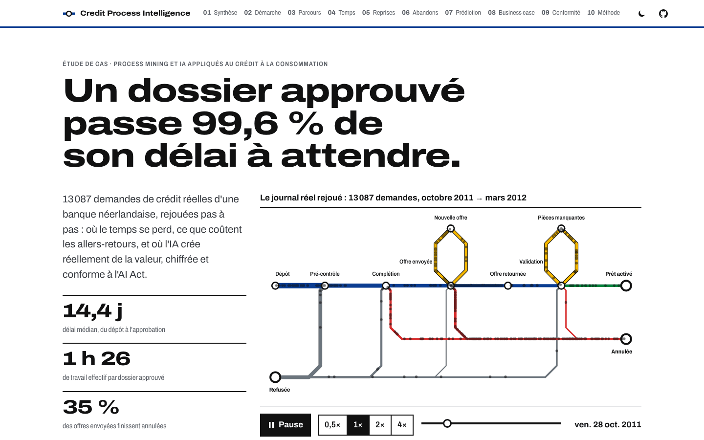
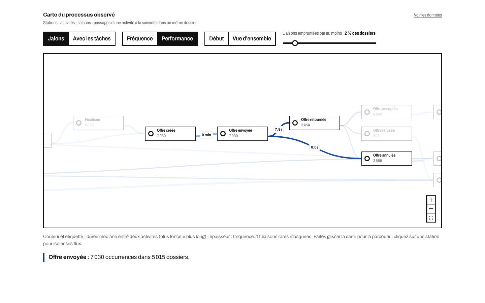
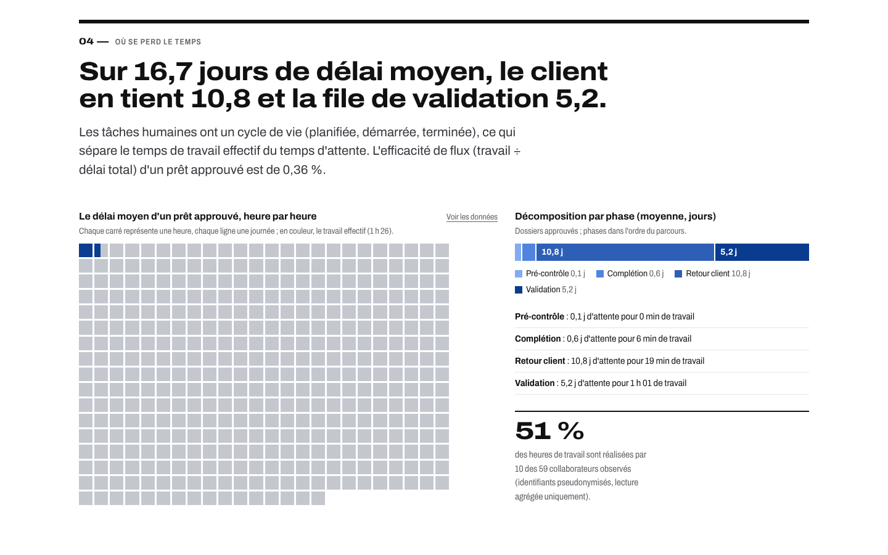
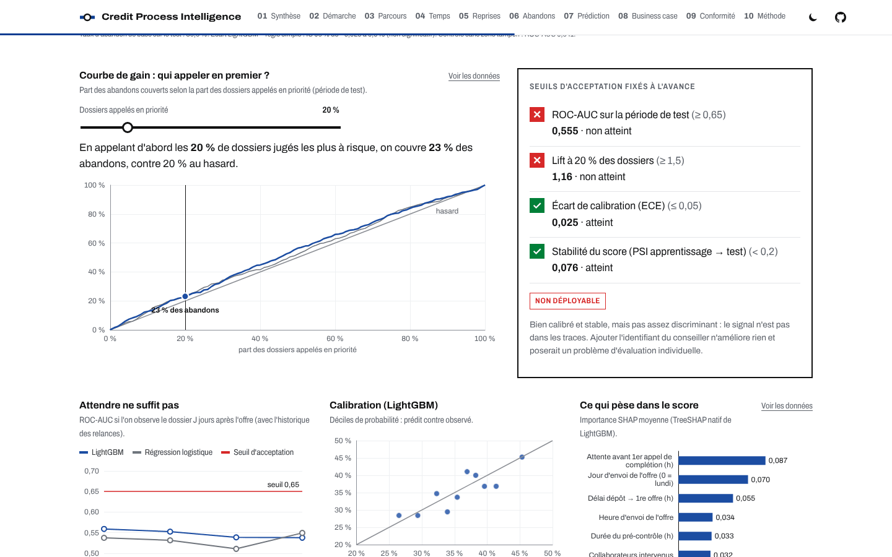
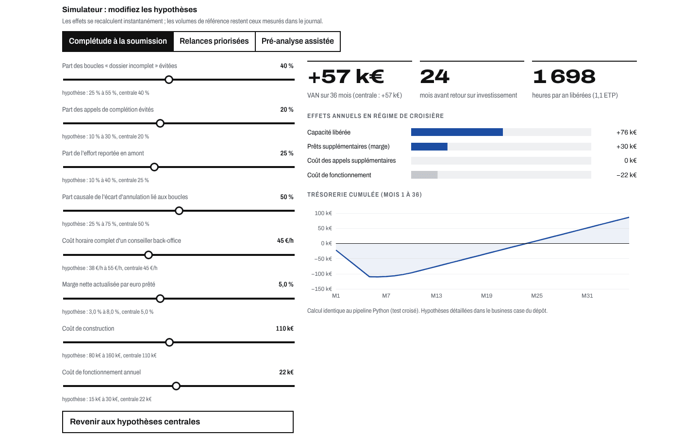
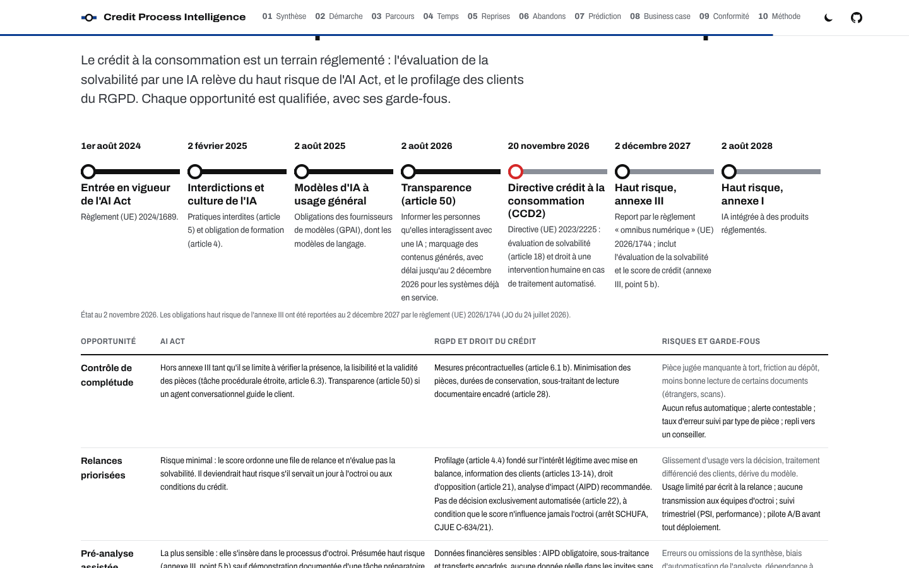
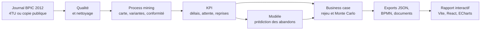

# Credit Process Intelligence

> Le diagnostic data et IA d'un processus réel de crédit à la consommation, pour les directions des opérations, les Business Analysts et les équipes conformité, afin de savoir où l'IA rapporte vraiment, combien, et à quelles conditions.

**[Voir la démo](https://youssefmir.github.io/credit-process-intelligence/)** · [Démarche BA](#la-démarche-business-analyst) · [Résultats clés](#ce-que-révèlent-les-données)


*Ouverture du rapport interactif : le constat clé et le rejeu animé des 13 087 demandes réelles sur un plan de réseau.*

## En bref

- **Le problème** : entre la demande de crédit et le prêt activé, une banque perd du temps et des clients sans savoir précisément où, ni combien.
- **La solution** : le process mining (reconstitution du processus réel à partir des journaux d'événements d'un système d'information) appliqué à 13 087 demandes réelles, puis un business case IA chiffré et qualifié au regard de l'AI Act et du RGPD.
- **Les résultats** : un dossier approuvé passe 99,6 % de son délai à attendre ; 51 % des dossiers validés repartent chercher des pièces ; une seule des trois opportunités IA est rentable, le contrôle de complétude (VAN médiane +48 k€ sur 3 ans).
- **Pour qui** : directions des opérations crédit, Business Analysts, équipes conformité, risques et data.

## Sommaire

- [Essayer en 1 minute](#essayer-en-1-minute)
- [Ce que vous pouvez faire](#ce-que-vous-pouvez-faire)
- [Ce que révèlent les données](#ce-que-révèlent-les-données)
- [Opportunités IA et business case](#opportunités-ia-et-business-case)
- [Comment ça marche](#comment-ça-marche)
- [La démarche Business Analyst](#la-démarche-business-analyst)
- [Référence des commandes](#référence-des-commandes)
- [Qualité, données et limites](#qualité-données-et-limites)
- [FAQ](#faq)
- [Auteur et licence](#auteur-et-licence)

## Essayer en 1 minute

1. En ligne, sans installation : [youssefmir.github.io/credit-process-intelligence](https://youssefmir.github.io/credit-process-intelligence/).
2. En local, avec git, make et Node.js 20 ou plus (les résultats du pipeline sont déjà dans le dépôt) :

```bash
git clone https://github.com/youssefmir/credit-process-intelligence.git
cd credit-process-intelligence
make demo
```

Le rapport s'ouvre sur [localhost:4173/credit-process-intelligence/](http://localhost:4173/credit-process-intelligence/). Pour tout recalculer depuis les données brutes, voir la [référence des commandes](#référence-des-commandes).

## Ce que vous pouvez faire

### Voir le processus réel, avec ses durées

La carte de processus montre chaque étape et chaque passage d'une étape à l'autre. En mode performance, la couleur indique la durée médiane : les liaisons qui partent de l'offre envoyée, vers son retour signé (7,9 jours) ou vers son annulation (8,0 jours), sont les plus longues.


*Carte de processus interactive : fréquence ou performance, seuil des liaisons, isolement d'une étape.*

### Mesurer où se perd le temps

Le cycle de vie des tâches (planifiée, démarrée, terminée) sépare le travail effectif du temps d'attente. Chaque carré représente une heure du délai moyen d'un prêt approuvé, chaque ligne une journée, soit 400 carrés ; le travail effectif n'en remplit que 1,4 (1 h 26).


*Délai heure par heure et décomposition par phase : le client tient 10,8 jours, la file de validation 5,2.*

### Évaluer honnêtement un modèle prédictif

Le modèle tente de prédire l'abandon dès l'envoi de la première offre, avec un découpage temporel strict et des seuils d'acceptation fixés à l'avance. Il ne les atteint pas : il n'est pas mis en production.


*Courbe de gain et seuils d'acceptation : appeler d'abord 20 % des dossiers ne couvre que 23 % des abandons.*

### Chiffrer une opportunité IA avec vos propres hypothèses

Le simulateur recalcule la valeur actuelle nette (VAN, somme des flux futurs actualisés), le délai de retour sur investissement et les effets annuels quand on déplace un curseur. Le calcul est identique à celui du pipeline Python, ce qu'un test vérifie.


*Simulateur what-if : chaque hypothèse affiche sa fourchette et sa valeur centrale.*

### Qualifier un cas d'usage au regard de l'AI Act et du RGPD

Chaque opportunité est qualifiée : catégorie de risque AI Act, base légale RGPD, risques et garde-fous, avec le calendrier réglementaire à jour et ses sources.


*Calendrier réglementaire et qualification des trois opportunités.*

## Ce que révèlent les données

| Question | Constat mesuré | Ce que cela implique |
|---|---|---|
| Quel est le parcours réel ? | 5 variantes couvrent 81 % des demandes ; 35 % des prêts approuvés suivent le chemin nominal sans reprise | Un processus standard, mais beaucoup de reprises sur les dossiers qui aboutissent |
| Où se perd le temps ? | 16,7 jours de délai moyen pour 1 h 26 de travail : efficacité de flux de 0,36 % | Le levier est l'attente (client, file de validation), pas la productivité |
| Combien coûtent les allers-retours ? | 51 % des dossiers validés repartent chercher des pièces ; 6 313 heures de relances et de reprises par an | Vérifier les pièces dès le dépôt évite des boucles entières |
| Qui abandonne ? | 35 % des offres envoyées finissent annulées, dont 36 % à l'expiration des 30 jours | Le client qui ne renvoie pas son offre est la première fuite de valeur |
| Peut-on prédire l'abandon ? | ROC-AUC de 0,56 sur la période de test, à peine mieux qu'une règle simple | Le signal n'est pas dans les traces : tester une relance renforcée avant tout score |

Une variante est une séquence distincte d'étapes ; l'efficacité de flux rapporte le travail effectif au délai total ; la ROC-AUC mesure la capacité d'un modèle à classer les abandons avant les autres dossiers (0,5 : hasard ; 1 : classement parfait). Le détail, avec les contrôles de qualité des données, est dans [l'analyse AS-IS](docs/02-analyse-as-is.md).

## Opportunités IA et business case

Chaque opportunité part d'un constat mesuré. Les dossiers réels sont rejoués avec et sans l'apport de l'IA (rejeu contrefactuel), puis 5 000 tirages de Monte Carlo font varier les hypothèses dans leur fourchette.

| Opportunité | VAN 3 ans, médiane (P10 à P90) | VAN positive | Recommandation |
|---|---|---|---|
| Contrôle automatique de complétude au dépôt | +48 k€ (−4 à +108 k€) | 88 % des tirages | Lancer |
| Relances d'offres priorisées par score d'abandon | +1 k€ (−45 à +68 k€) | 51 % des tirages | Pilote A/B sur une règle simple |
| Pré-analyse assistée des dossiers à valider | −89 k€ (−132 à −45 k€) | moins de 1 % des tirages | Différer |

P10 et P90 bornent 80 % des tirages ; un pilote A/B compare deux groupes de dossiers tirés au sort. Les coûts, le coût horaire et les taux de réduction sont des **hypothèses** explicites et justifiées ([`config/hypotheses.yaml`](config/hypotheses.yaml)) ; la marge sur un prêt supplémentaire est étalonnée sur les offres du BPI Challenge 2017. Détail et sensibilité : [business case](docs/05-business-case.md). Qualification réglementaire : [conformité AI Act et RGPD](docs/06-conformite-ia-rgpd.md).

## Comment ça marche



- Un paquet Python (`src/cpi`) enchaîne acquisition, qualité, process mining (pm4py), KPI, modèle (scikit-learn, LightGBM) et simulation.
- Une seule commande régénère tout ; la graine est fixe et deux exécutions produisent des exports identiques.
- Les documents chiffrés et les modèles BPMN sont générés à partir des mêmes exports : aucun chiffre saisi à la main.
- Le rapport est un site statique (Vite, React, TypeScript, ECharts, React Flow, bpmn-js), sans appel réseau au chargement.
- Le [carnet d'analyse](notebooks/analyse-processus-credit.ipynb) raconte la démarche pas à pas, sorties comprises.

## La démarche Business Analyst

| Livrable | Ce qu'il apporte | Lien |
|---|---|---|
| Note de cadrage | Questions métier, périmètre, parties prenantes, risques de la mission | [01-note-de-cadrage.md](docs/01-note-de-cadrage.md) |
| Analyse AS-IS | Constats chiffrés, qualité des données, table de traduction des activités | [02-analyse-as-is.md](docs/02-analyse-as-is.md) |
| BPMN AS-IS et TO-BE | Processus observé et processus cible, en BPMN 2.0 annoté | [03-modelisation-bpmn.md](docs/03-modelisation-bpmn.md) |
| User stories | Épopées, stories INVEST, critères Gherkin, priorités MoSCoW | [04-user-stories.md](docs/04-user-stories.md) |
| Business case | Hypothèses justifiées, résultats, sensibilité, recommandation | [05-business-case.md](docs/05-business-case.md) |
| Conformité IA et RGPD | Qualification AI Act, RGPD et CCD2, fiche modèle, registre des risques | [06-conformite-ia-rgpd.md](docs/06-conformite-ia-rgpd.md) |
| Plan de recette | Tests de données, seuils du modèle, scénarios métier | [07-plan-de-recette.md](docs/07-plan-de-recette.md) |
| Conduite du changement | Impacts, parties prenantes, formation, indicateurs d'adoption | [08-conduite-du-changement.md](docs/08-conduite-du-changement.md) |
| Journal des décisions | Choix structurants, options écartées, direction artistique | [decisions.md](docs/decisions.md) |

## Référence des commandes

Prérequis : [uv](https://docs.astral.sh/uv/) (installe Python 3.12), Node.js 20 ou plus avec npm, git, make.

| Commande | Effet |
|---|---|
| `make demo` | Construit et sert le rapport (Node.js seul) |
| `make install` | Installe les dépendances Python, du site et Chromium |
| `make data` | Télécharge et vérifie les journaux (4TU, sinon copie publique) |
| `make pipeline` | Recalcule analyses, exports, BPMN et documents |
| `make notebook` | Exécute le carnet d'analyse |
| `make test` | Lance les tests Python et du site |
| `make e2e` | Lance le test de bout en bout dans Chromium |
| `make lint` | Vérifie lint, typage et typographie |
| `make screenshots` | Régénère les captures de `docs/img` |
| `make all` | Enchaîne tout, de l'installation aux captures |

`make help` liste toutes les cibles, dont `make reproductibilite` (relance le pipeline et vérifie que rien ne change).

## Qualité, données et limites

**Tests.** `make test` couvre les KPI sur un mini-journal synthétique calculé à la main, l'absence de fuite d'information dans le modèle, sa reproductibilité, les invariants du business case, les contrats des exports et la concordance entre le calcul Python et le simulateur du site. `make e2e` vérifie le rapport dans un navigateur (chargement, rejeu, thème, carte, simulateur, BPMN, affichage mobile). Un test vérifie aussi que chaque chiffre clé de ce README est celui que calcule le pipeline.

**Données.** BPI Challenge 2012 : journal réel et anonymisé d'une institution financière néerlandaise, 13 087 demandes et 262 200 événements, d'octobre 2011 à mars 2012 ([DOI 10.4121/uuid:3926db30-f712-4394-aebc-75976070e91f](https://doi.org/10.4121/uuid:3926db30-f712-4394-aebc-75976070e91f)). Les données brutes ne sont pas versionnées : `make data` les télécharge et vérifie leurs comptes.

**Limites.**

- Cinq mois observés : les volumes annuels sont extrapolés (× 2,40) et la saisonnalité n'est pas connue.
- Le journal ne contient ni motif d'annulation, ni pièce justificative, ni attribut sensible : l'équité du modèle ne peut pas être mesurée.
- Les coûts de construction et de fonctionnement sont des ordres de grandeur, à remplacer par des devis.
- Les heures libérées sont une capacité redéployable, pas forcément une économie de trésorerie.
- La rédaction de fiches par un modèle de langage est facultative (clé fournie par l'utilisateur) ; elle n'a pas été testée en conditions réelles et aucune sortie n'est affichée.
- L'analyse réglementaire prépare l'instruction par la conformité ; ce n'est pas un avis juridique.

## FAQ

**Les chiffres sont-ils réels ?**
Oui pour tout ce qui est mesuré : ils sont recalculés par le pipeline à partir du journal public. Les coûts et taux de réduction du business case sont des hypothèses, signalées comme telles, avec une fourchette.

**Pourquoi publier un modèle qui ne marche pas ?**
Parce que la bonne décision est de ne pas le déployer. Les seuils étaient fixés avant l'évaluation ; le résultat oriente vers un pilote A/B à faible coût plutôt qu'un investissement dans un score inutile.

**Le modèle décide-t-il qui obtient un crédit ?**
Non. Il ne servirait qu'à ordonner une file de relance. Un score d'octroi serait un système d'IA à haut risque (AI Act, annexe III, point 5 b) ; le projet se tient volontairement en dehors.

**Puis-je réutiliser la démarche sur mes propres données ?**
Oui, si votre journal suit le format XES ou une table d'événements équivalente (dossier, activité, horodatage). L'ingestion et la table de traduction des activités sont à adapter.

**Faut-il une clé d'API pour utiliser le projet ?**
Non. Tout fonctionne sans clé ; seule la rédaction facultative d'une fiche par un modèle de langage en demande une (`python -m cpi assistant <dossier> --llm`).

## Auteur et licence

Youssef Mir, Business Analyst IA · [github.com/youssefmir](https://github.com/youssefmir)

Code sous [licence MIT](LICENSE). Données : BPI Challenge 2012, van Dongen, B. (2012), 4TU.ResearchData, conditions « 4TU General Terms of Use » (citation obligatoire) ; BPI Challenge 2017 – Offer log, van Dongen, B. (2017), 4TU.ResearchData, [DOI 10.4121/uuid:7e326e7e-8b93-4701-8860-71213edf0fbe](https://doi.org/10.4121/uuid:7e326e7e-8b93-4701-8860-71213edf0fbe). Dépendances sous leurs propres licences, dont pm4py (AGPL-3.0).
