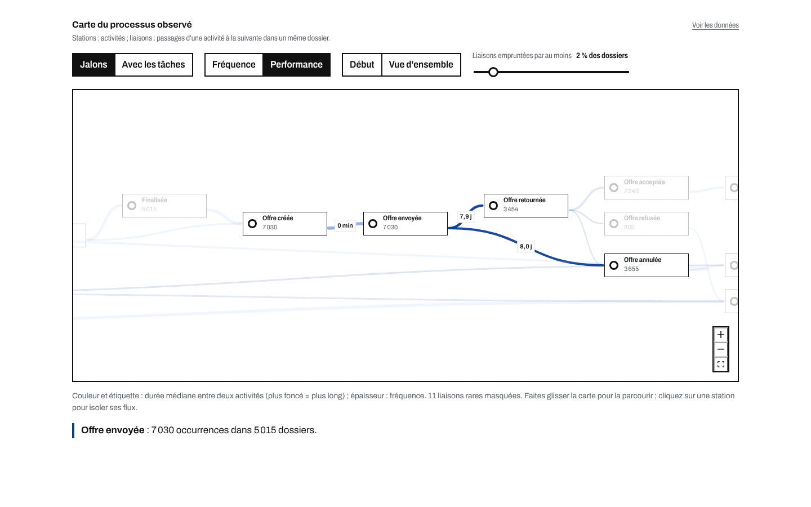

# Analyse AS-IS — le processus de crédit tel qu'il se déroule

> Document généré par `make docs` à partir des exports du pipeline (`site/public/data`). Aucun chiffre n'est saisi à la main.

## Synthèse

| Constat | Valeur mesurée |
|---|---|
| Demandes analysées | 13 087 (262 200 événements) |
| Issues | 17 % approuvées, 58 % refusées, 21 % annulées |
| Délai médian d'un prêt approuvé | 14,4 j (moyenne 16,7 j) |
| Travail effectif moyen par prêt approuvé | 1,43 h |
| Efficacité de flux (travail ÷ délai) | 0,36 % |
| Prêts approuvés sans aucune reprise | 35 % |
| Dossiers validés passés par une boucle « incomplet » | 51 % |
| Heures de relances et de reprises par an | 6 313 h |
| Offres envoyées finalement annulées | 35 % |

Lecture : le délai d'un dossier n'est presque jamais du travail. Il se passe à attendre le client (retour de l'offre signée) puis la file de validation. Le travail humain annuel est modeste (16 330 h par an, soit environ 10 équivalents temps plein), alors que les abandons portent sur des milliers de dossiers : la valeur est davantage dans la conversion que dans la productivité.

*La carte de processus en mode performance, station « Offre envoyée » isolée : son retour signé (médiane 7,9 j) et son annulation (8,0 j) sont les deux liaisons fréquentes les plus longues du parcours.*

## 1. Données et qualité

Source : van Dongen, B. (2012). BPI Challenge 2012. 4TU.ResearchData. https://doi.org/10.4121/uuid:3926db30-f712-4394-aebc-75976070e91f. Période : 1er octobre 2011 → 14 mars 2012. Volume annualisé : 31 424 demandes par an (facteur 2,40 : 365 jours rapportés aux 152 jours de dépôts observés).

| Contrôle | Statut | Résultat | Traitement |
|---|---|---|---|
| Volumétrie conforme à la source | conforme | 13 087 dossiers · 262 200 événements | Arrêt du pipeline en cas d'écart. |
| Champs obligatoires renseignés | conforme | aucune valeur manquante | Aucun. |
| Période couverte | information | 01/10/2011 → 14/03/2012 | Annualisation explicite des volumes (voir le business case). |
| Doublons exacts | conforme | aucun doublon | Aucun. |
| Ressource non renseignée | traité | 18 010 événements (6,9 %) | Analyses de charge sur les sessions dont la ressource est connue. |
| Jalons enregistrés au même instant | traité | 4 116 dossiers concernés | Réordonnancement canonique des jalons A_/O_ distants de moins d'1 s ; durées calculées sur les horodatages réels. |
| Fin de tâche sans démarrage | traité | 1 040 sessions | Session conservée, durée imputée à la médiane de l'activité. |
| Démarrage sans fin de tâche | information | 3 sessions | Sessions ignorées dans le temps de travail. |
| Sessions de plus de 2 h | traité | 477 sessions (0,66 %) | Durée imputée à la médiane de l'activité : 6 801 h de travail retenues (estimation prudente). |
| Tâche planifiée jamais exécutée | information | 12 planifications | Exclue des analyses de travail. |
| Montant demandé | information | médiane 10 000 € · max 99 999 € | Conservé tel quel ; analyses par tranches de montant. |
| Dossiers sans issue à la fin du journal | information | 399 dossiers (3,0 %) | Exclus des délais et du modèle (issue inconnue). |
| Une seule issue par dossier | conforme | aucun conflit | Aucun. |
| Chaque dossier commence par le dépôt | conforme | aucune exception | Aucun. |

**Sessions de travail.** Le cycle de vie des tâches (planifiée, démarrée, terminée) permet de mesurer le travail effectif. Une session de plus de deux heures sur un appel ou un contrôle est considérée comme restée ouverte : 477 sessions (0,66 %) pèsent 7 618 h sur 14 358 h brutes. Leur durée est remplacée par la médiane de l'activité. Sensibilité au seuil :

| Seuil de session non clôturée | Heures de travail retenues | Sessions imputées |
|---|---|---|
| 0,5 h | 5 336 h | 5,0 % |
| 1,0 h | 6 299 h | 2,7 % |
| 2,0 h | 6 801 h | 2,1 % |
| 4,0 h | 7 161 h | 1,9 % |
| 8,0 h | 7 380 h | 1,8 % |

Le seuil de deux heures est un compromis prudent : il retient l'essentiel du travail réel sans compter les sessions oubliées.

## 2. Q1 — Le parcours réel

### Issues

| Issue | Demandes | Part |
|---|---|---|
| Approuvée | 2 246 | 17,2 % |
| Refusée | 7 635 | 58,3 % |
| Annulée | 2 807 | 21,5 % |
| En cours | 399 | 3,1 % |

### Variantes

Une variante est une séquence distincte d'étapes. Sur les jalons de la demande et de l'offre, on compte 86 variantes ; les 5 premières couvrent 81 % des dossiers, les 10 premières 92 %. Avec les tâches humaines (répétitions regroupées), on en compte 936.

| Rang | Dossiers | Part | Issue majoritaire | Délai médian | Parcours (jalons) |
|---|---|---|---|---|---|
| 1 | 5 719 | 43,7 % | Refusée | 0,0 j | Demande soumise → Demande enregistrée → Refusée |
| 2 | 1 537 | 11,7 % | Approuvée | 13,1 j | Demande soumise → Demande enregistrée → Pré-acceptée → Demande complétée → Offre sélectionnée → Demande finalisée → Offre créée → Offre envoyée → Offre retournée signée → Offre acceptée → Approuvée → Enregistrée au contrat → Prêt activé |
| 3 | 1 132 | 8,6 % | Annulée | 18,9 j | Demande soumise → Demande enregistrée → Pré-acceptée → Demande complétée → Offre sélectionnée → Demande finalisée → Offre créée → Offre envoyée → Offre annulée → Annulée |
| 4 | 1 100 | 8,4 % | Annulée | 4,2 j | Demande soumise → Demande enregistrée → Pré-acceptée → Annulée |
| 5 | 1 085 | 8,3 % | Refusée | 0,7 j | Demande soumise → Demande enregistrée → Pré-acceptée → Refusée |
| 6 | 574 | 4,4 % | Refusée | 13,5 j | Demande soumise → Demande enregistrée → Pré-acceptée → Demande complétée → Offre sélectionnée → Demande finalisée → Offre créée → Offre envoyée → Offre retournée signée → Offre refusée → Refusée |
| 7 | 318 | 2,4 % | Approuvée | 16,8 j | Demande soumise → Demande enregistrée → Pré-acceptée → Demande complétée → Offre sélectionnée → Demande finalisée → Offre créée → Offre envoyée → Offre annulée → Offre sélectionnée → Offre créée → Offre envoyée → Offre retournée signée → Offre acceptée → Approuvée → Enregistrée au contrat → Prêt activé |
| 8 | 294 | 2,2 % | Annulée | 28,2 j | Demande soumise → Demande enregistrée → Pré-acceptée → Demande complétée → Offre sélectionnée → Demande finalisée → Offre créée → Offre envoyée → Offre annulée → Offre sélectionnée → Offre créée → Offre envoyée → Offre annulée → Annulée |

### Conformité au chemin nominal

Le chemin nominal d'un prêt approuvé compte 13 jalons, une seule offre et aucune reprise. L'alignement de chaque dossier approuvé sur ce chemin (pm4py) donne :

- 68 % des prêts approuvés suivent exactement les jalons nominaux (fitness moyenne 0,94) ;
- 35 % les suivent sans boucle « dossier incomplet » ;
- délai médian : 11,9 j pour ces dossiers, 16,1 j pour les autres ;
- écarts les plus fréquents : offre créée en trop (1 079), offre envoyée en trop (1 079), offre annulée en trop (1 079), offre sélectionnée en trop (1 079).

### Modèle découvert automatiquement

Inductive Miner infrequent (pm4py), filtre de bruit 0,2 : fitness 0,984 (70 % des dossiers parfaitement rejoués), précision 0,288. Le modèle explique presque tout ce qui arrive, mais autorise bien plus de parcours qu'il n'en existe : la variabilité réelle impose une lecture par variantes et un BPMN métier simplifié (voir [la modélisation BPMN](03-modelisation-bpmn.md)).

## 3. Q2 — Combien de temps, et où se perd-il ?

### Délais jusqu'à l'issue

| Issue | P25 | Médiane | P75 | P90 | Moyenne |
|---|---|---|---|---|---|
| Approuvées | 10,6 j | 14,4 j | 20,0 j | 28,7 j | 16,7 j |
| Annulées | 6,8 j | 16,9 j | 30,8 j | 31,8 j | 18,6 j |
| Refusées | 0,0 j | 0,0 j | 0,5 j | 7,9 j | 2,1 j |

62 % des refus tombent en moins d'une heure : le pré-contrôle automatique écarte la majorité des demandes refusées.

### Attente contre travail (prêts approuvés)

| Phase | Délai moyen | Délai médian | Travail moyen |
|---|---|---|---|
| Pré-contrôle | 0,07 j | 0,00 j | 0 min |
| Complétion | 0,59 j | 0,13 j | 6 min |
| Retour client | 10,84 j | 8,84 j | 19 min |
| Validation | 5,16 j | 4,11 j | 61 min |

Efficacité de flux : 0,36 % pour les prêts approuvés, 0,14 % pour les dossiers annulés.

### Tâches humaines

| Tâche | Sessions | Dossiers | Sessions par dossier | Session médiane | Attente médiane en file | Heures observées |
|---|---|---|---|---|---|---|
| Traitement des leads | 5 898 | 4 755 | 1,2 | 1,9 min | 0,7 h | 389 h |
| Complétion de la demande | 23 967 | 7 367 | 3,3 | 2,7 min | 1,8 h | 2 164 h |
| Relance des offres | 22 976 | 5 011 | 4,6 | 1,7 min | 0,0 h | 1 093 h |
| Validation de la demande | 7 895 | 3 209 | 2,5 | 12,0 min | 25,8 h | 2 126 h |
| Relance des dossiers incomplets | 11 407 | 1 647 | 6,9 | 2,1 min | 0,7 h | 1 026 h |
| Évaluation fraude | 270 | 108 | 2,5 | 0,2 min | 10,2 h | 2 h |

La validation concentre la plus longue attente en file (médiane 25,8 h) et les sessions les plus longues ; les relances d'offres sont nombreuses mais courtes.

### Où s'accumule le temps

| Transition (jalons) | Passages | Durée médiane | Part du temps cumulé |
|---|---|---|---|
| Offre envoyée → Offre annulée | 3 151 | 8,0 j | 35 % |
| Offre envoyée → Offre retournée signée | 3 454 | 7,9 j | 31 % |
| Pré-acceptée → Annulée | 1 100 | 4,1 j | 14 % |
| Offre retournée signée → Offre acceptée | 2 113 | 3,8 j | 8 % |
| Pré-acceptée → Demande complétée | 5 113 | 0,2 j | 4 % |
| Offre retournée signée → Offre annulée | 504 | 4,2 j | 3 % |

### Charge

59 collaborateurs (identifiants pseudonymisés) réalisent des sessions de travail. Les 10 plus chargés réalisent 51 % des heures (indice de Gini 0,56) ; 22 % consacrent au moins 80 % de leur temps à une seule tâche. Ces données servent au dimensionnement collectif, jamais à une évaluation individuelle.

## 4. Q3 — Le coût des allers-retours

| Boucle | Volume | Travail | Délai |
|---|---|---|---|
| Dossier incomplet (relance pour pièces, puis re-validation) | 1 647 dossiers (51 % des dossiers validés), 11 407 appels | 1 026 h d'appels + 510 h de re-validation, soit 3 689 h par an | médiane 2,1 j, moyenne 4,5 j |
| Offres multiples | 1 438 dossiers (29 % des dossiers ayant reçu une offre), 2 015 offres en plus | 832 h par an de relances après une 2e offre | 7,0 j entre première et dernière offre |
| Relances d'offres | 22 976 appels sur 5 011 dossiers | 2 625 h par an, dont 46 % sur des dossiers finalement annulés | retour médian de l'offre signée : 9,0 j |

Délai médian des prêts approuvés : 16,1 j avec une boucle « incomplet », 12,7 j sans. Les dossiers annulés reçoivent en moyenne 6,2 appels de relance, contre 3,6 pour les dossiers approuvés.

## 5. Q4 — Qui abandonne, quand, et pourquoi

2 807 dossiers sont annulés (22 % des dossiers clos). Parmi les dossiers ayant reçu une offre, 35 % finissent annulés et 48 % approuvés.

| Étape d'annulation | Dossiers | Part | Délai médian depuis le dépôt |
|---|---|---|---|
| Au pré-contrôle | 1 | 0,0 % | 0,5 j |
| En complétion (avant offre) | 1 166 | 41,5 % | 3,4 j |
| Offre envoyée, non retournée | 1 482 | 52,8 % | 20,5 j |
| Offre retournée, en validation | 158 | 5,6 % | 19,4 j |

**L'expiration de l'offre.** 36 % des annulations postérieures à une offre surviennent entre 29 et 32 jours après la dernière offre : le client ne l'a jamais renvoyée et le dossier est clos à l'expiration.

**Le délai avant la première offre.** Le taux d'annulation croît avec ce délai :

| Délai dépôt → 1re offre | Dossiers | Taux d'annulation |
|---|---|---|
| < 1 j | 3 753 | 33,9 % |
| 1–3 j | 693 | 39,0 % |
| 3–7 j | 173 | 41,0 % |
| 7–14 j | 52 | 44,2 % |
| ≥ 14 j | 17 | 23,5 % |

**Le montant.** Montant médian demandé : 13 000 € pour les prêts approuvés, 10 000 € pour les dossiers annulés, 8 000 € pour les refus. Les petits montants (moins de 5 k€) ayant reçu une offre sont les plus souvent annulés (47 %).

Le « pourquoi » reste une inférence : le journal ne contient pas de motif. Les signaux convergent vers un client qui ne revient pas (offre non renvoyée), d'autant plus que le processus est long.

## Annexe — Table de traduction des activités

| Code du journal | Libellé | Type | Description |
|---|---|---|---|
| `A_SUBMITTED` | Demande soumise | Demande | Le client dépose sa demande de crédit (en ligne). |
| `A_PARTLYSUBMITTED` | Demande enregistrée | Demande | Enregistrement technique de la demande, quelques instants après le dépôt. |
| `A_PREACCEPTED` | Pré-acceptée | Demande | La demande passe le pré-contrôle automatique ; des compléments sont nécessaires. |
| `A_ACCEPTED` | Demande complétée | Demande | Demande complétée et jugée recevable : une offre peut être préparée. |
| `O_CANCELLED` | Offre annulée | Offre | Offre annulée : remplacée par une nouvelle offre ou dossier clos. |
| `O_SELECTED` | Offre sélectionnée | Offre | Choix des conditions (montant, durée) de l'offre proposée. |
| `A_FINALIZED` | Demande finalisée | Demande | Demande finalisée pour l'envoi d'une offre. |
| `O_CREATED` | Offre créée | Offre | Création du document d'offre. |
| `O_SENT` | Offre envoyée | Offre | Envoi de l'offre au client, qui doit la retourner signée. |
| `O_SENT_BACK` | Offre retournée signée | Offre | Le client renvoie l'offre signée, avec ses justificatifs. |
| `O_ACCEPTED` | Offre acceptée | Offre | L'offre signée est acceptée par l'institution. |
| `A_APPROVED` | Approuvée | Demande | Décision favorable sur la demande. |
| `A_REGISTERED` | Enregistrée au contrat | Demande | Enregistrement du contrat de prêt. |
| `A_ACTIVATED` | Prêt activé | Demande | Mise à disposition du prêt : issue positive du dossier. |
| `O_DECLINED` | Offre refusée | Offre | L'offre est refusée par l'institution après examen. |
| `A_DECLINED` | Refusée | Demande | Refus de la demande (automatique au pré-contrôle ou après examen). |
| `A_CANCELLED` | Annulée | Demande | Dossier annulé : abandon du client ou clôture faute de retour. |
| `W_Afhandelen leads` | Traitement des leads | Tâche humaine | Appel de qualification d'une demande (lead) avant ou après le pré-contrôle. |
| `W_Completeren aanvraag` | Complétion de la demande | Tâche humaine | Appels au client pour compléter la demande avant l'offre. |
| `W_Nabellen offertes` | Relance des offres | Tâche humaine | Appels de relance tant que l'offre envoyée n'est pas retournée signée. |
| `W_Valideren aanvraag` | Validation de la demande | Tâche humaine | Contrôle du dossier retourné (pièces, cohérence) avant décision. |
| `W_Nabellen incomplete dossiers` | Relance des dossiers incomplets | Tâche humaine | Appels pour obtenir les pièces manquantes détectées à la validation. |
| `W_Beoordelen fraude` | Évaluation fraude | Tâche humaine | Examen d'une suspicion de fraude. |
| `W_Wijzigen contractgegevens` | Modification du contrat | Tâche humaine | Modification des données du contrat (planifiée 12 fois, jamais exécutée). |
