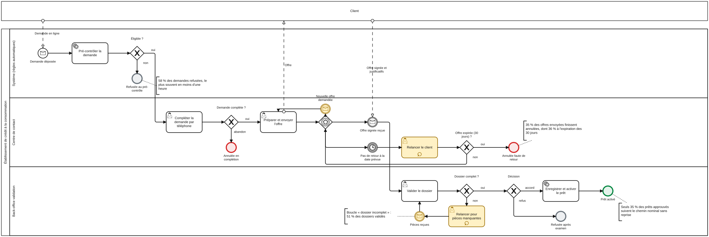
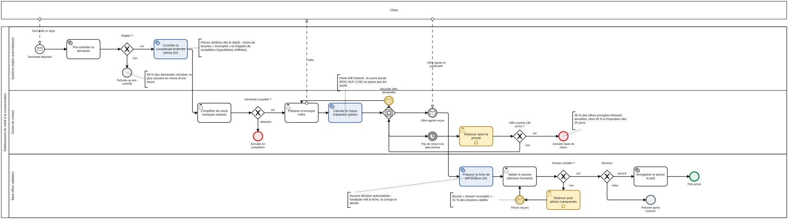

# Modélisation BPMN — AS-IS et TO-BE

> Document généré par `make docs`. Les modèles `bpmn/as-is.bpmn` et `bpmn/to-be.bpmn` sont produits par le pipeline (`src/cpi/bpmn.py`) au format BPMN 2.0 standard, avec diagramme et couloirs ; les images SVG sont rendues par bpmn-js (`make bpmn-svg`).

## Principes

- Un modèle **métier**, pas un modèle découvert : le journal contient 86 variantes de jalons ; le BPMN décrit le chemin et les boucles qui structurent le processus, les variantes rares restent dans l'analyse.
- Deux participants : le **client** (boîte noire) et l'**établissement**, découpé en trois couloirs (système, centre de contact, back-office validation).
- Les annotations portent des chiffres mesurés, injectés par le pipeline.
- Code couleur : jaune pour les boucles de reprise, bleu pour les apports de l'IA, rouge pour les annulations, gris pour les refus, vert pour le prêt activé.

## AS-IS : le processus observé

*Le processus observé : pré-contrôle automatique, complétion par téléphone, offre et relances, validation avec boucle « dossier incomplet ».*

Points saillants :

- **Pré-contrôle** : 58 % des demandes sont refusées, le plus souvent en moins d'une heure.
- **Attente de l'offre signée** : une passerelle événementielle attend le retour du client, une relance programmée ou une demande de nouvelle offre ; 35 % des offres envoyées finissent annulées, dont 36 % à l'expiration des 30 jours.
- **Validation** : 51 % des dossiers validés repartent chercher des pièces (boucle jaune) ; seuls 35 % des prêts approuvés suivent le chemin nominal sans reprise.

## TO-BE : le processus cible

*Le processus cible : trois tâches outillées par l'IA (en bleu), la décision de crédit reste humaine.*

| Apport | Où | Ce qui change | Ce qui ne change pas |
|---|---|---|---|
| Contrôle de complétude et lecture des pièces | Système, juste après le pré-contrôle | Les manques sont signalés au client dès le dépôt ; le centre de contact ne complète que les manques restants | Aucun refus automatique ; un conseiller peut toujours reprendre la main |
| Calcul du risque d'abandon (pilote) | Centre de contact, après l'envoi de l'offre | La file de relance est triée par risque | Ne sert jamais à l'octroi ; pilote A/B avant tout déploiement (le score actuel ne passe pas les seuils : ROC-AUC 0,56) |
| Fiche de pré-analyse | Back-office, avant la validation | L'analyste reçoit une synthèse factuelle et des contrôles de cohérence | L'analyste vérifie, corrige et décide ; aucune décision automatisée |

## Correspondance avec le journal

| Élément BPMN | Activités du journal |
|---|---|
| Demande déposée | `A_SUBMITTED`, `A_PARTLYSUBMITTED` |
| Pré-contrôler la demande, Éligible ? | `A_PREACCEPTED` ou `A_DECLINED` |
| Compléter la demande par téléphone | `W_Completeren aanvraag`, `A_ACCEPTED` |
| Préparer et envoyer l'offre | `O_SELECTED`, `A_FINALIZED`, `O_CREATED`, `O_SENT` |
| Relancer le client | `W_Nabellen offertes` |
| Nouvelle offre demandée | `O_CANCELLED` suivi d'une nouvelle `O_SELECTED` |
| Offre signée reçue | `O_SENT_BACK` |
| Valider le dossier | `W_Valideren aanvraag` |
| Relancer pour pièces manquantes | `W_Nabellen incomplete dossiers` |
| Enregistrer et activer le prêt | `O_ACCEPTED`, `A_APPROVED`, `A_REGISTERED`, `A_ACTIVATED` |
| Annulée, Refusée | `A_CANCELLED`, `A_DECLINED` (et `O_CANCELLED`, `O_DECLINED`) |

Les fichiers BPMN s'ouvrent dans tout outil conforme (bpmn.io, Camunda Modeler, Signavio) et dans la visionneuse du rapport interactif.
